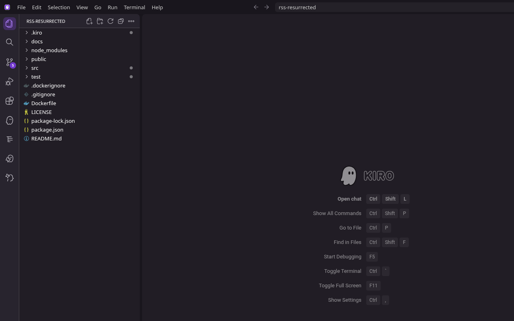
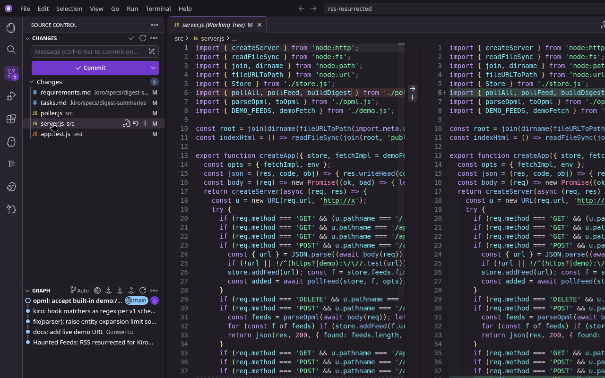
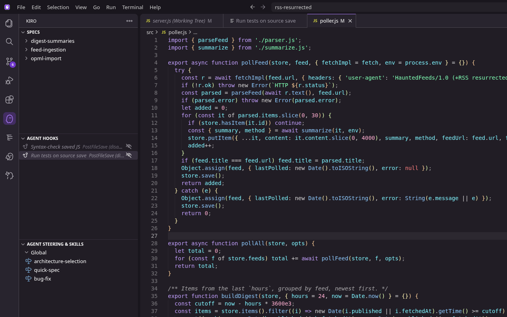
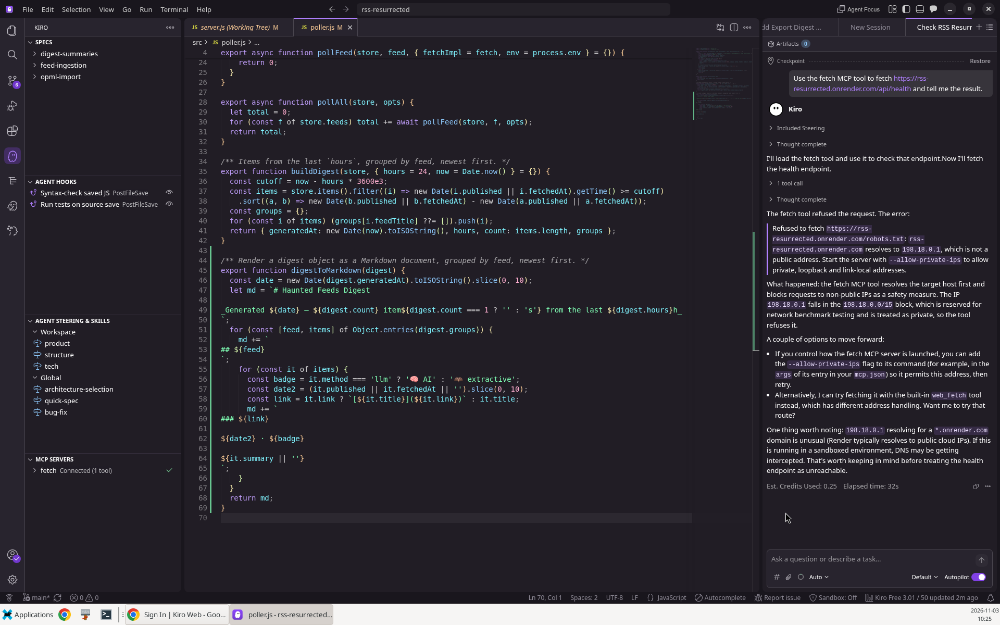

# How this project uses Kiro

Everything Kiro reads lives in `.kiro/`, in the formats from the [Kiro docs](https://kiro.dev/docs/). This page lists what each file is and how a Kiro user works with it. The section *What actually happened in Kiro* below describes the real Kiro session; everything else describes files in the repo.

| Kiro feature | Files | Format (per Kiro docs) | What it holds |
|---|---|---|---|
| [Steering](https://kiro.dev/docs/steering/) | `.kiro/steering/product.md`, `tech.md`, `structure.md` | Markdown with YAML front matter: `inclusion: always` (product, tech) and `inclusion: fileMatch` + `fileMatchPattern: ["src/**/*.js","test/**/*.js"]` (structure) | Product goal and tone, stack rules (Node 20, no build step, parsers never throw, no secrets), module map |
| [Specs](https://kiro.dev/docs/specs/) | `.kiro/specs/{feed-ingestion,digest-summaries,opml-import}/` | `requirements.md` (user story + EARS acceptance criteria), `design.md`, `tasks.md` (checkbox task list) | One spec per feature; the design lists correctness properties |
| [Hooks](https://kiro.dev/docs/hooks/) | `.kiro/hooks/run-tests-on-save.json`, `check-syntax-on-save.json` | `{"version":"v1","hooks":[{name, trigger, matcher, action}]}`, trigger `PostFileSave`, matcher is a regex on the file path, action `type: command` | `npm test` when `src/*.js` is saved; `node --check` on source modules when any `.js` is saved |
| [MCP](https://kiro.dev/docs/mcp/configuration/) | `.kiro/settings/mcp.json` | Workspace-level `mcpServers` object | `fetch` server via `uvx mcp-server-fetch` |

## What actually happened in Kiro
Kiro IDE 1.4.86 on Linux, signed in on the Kiro Free plan. The project was first written outside Kiro with the `.kiro/` files above in place; this section covers the session where Kiro itself was used on the repo.

### Spec mode: a new feature end to end
I asked in Spec mode for a Markdown export of the digest. Kiro:
1. Added **requirement 7** (EARS) to `.kiro/specs/digest-summaries/requirements.md`: *WHEN the user requests `GET /api/digest.md`, THE SYSTEM SHALL return a Markdown document with content-type `text/markdown`, built using the same digest logic…*
2. Added **task 6** to `.kiro/specs/digest-summaries/tasks.md`.
3. Implemented it: `digestToMarkdown` in `src/poller.js`, the `GET /api/digest.md` route in `src/server.js`, and a test in `test/app.test.js`.
4. Asked for approval, ran `npm test`, and got 12/12 passing.

One of its edits to `src/server.js` broke the file; Kiro noticed and fixed it itself before the tests passed. The whole run used about 4.4 credits.

### Hooks
Both hook files were recognized in the **Agent Hooks** panel and enabled there (Kiro wrote `"enabled": true` into `run-tests-on-save.json`). When I saved a file under `src/` by hand, I did **not** see the run-tests hook fire. I have not worked out why yet.

### MCP
The `fetch` server from `.kiro/settings/mcp.json` connected and exposed 1 tool. Kiro called `@fetch/fetch` on a real feed URL, and the tool refused the request: in my sandbox, DNS resolved the host to `198.18.0.1`, a reserved address the fetch server blocks. So MCP was wired up and invoked, but it did not return feed content in this environment.

### Not used
No custom agents and no Powers. Kiro did not generate the fast-check property tests; I wrote those.

## How a Kiro user uses these
- **Steering:** open the repo in Kiro. Files marked `always` load into every interaction; `structure.md` loads when you work on files matching its pattern. They show up in the Steering section of the Kiro panel.
- **Specs:** they appear under Specs in the Kiro panel. `tasks.md` is what Kiro's task execution interface tracks; requirements and design can be reviewed and edited before running tasks.
- **Hooks:** `.kiro/hooks/*.json` activate automatically when a session starts; the `PostFileSave` hooks run when a matching file is saved. Set `"enabled": false` to switch one off.
- **MCP:** Kiro merges `.kiro/settings/mcp.json` with the user-level config. The fetch server needs `uv` (`uvx`) installed.

## Correctness properties (fast-check)
From `.kiro/specs/feed-ingestion/design.md`, implemented in `test/parser.test.js` and run by `npm test`:
- P1 `dedupe` is idempotent, yields unique ids and preserves order.
- P2 `normalizeUrl` is idempotent and ignores `utm_source` and fragments.
- P3 a generated RSS feed with k distinct guids yields exactly k items, and the parser never throws.

## Regression found after deploy
Valid Atom feeds with lots of escaped HTML (e.g. blog.rust-lang.org) were rejected as `invalid-xml` because fast-xml-parser's default `maxTotalExpansions` (1000) counts standard entities. The fix (commit df40def) raises that cap while keeping DOCTYPE entity limits strict. `test/fixtures/atom-escaped-html.xml` covers it.

Links: [repo](https://github.com/lxivlog64/rss-resurrected) · [live demo](https://rss-resurrected.onrender.com) · [video](https://youtu.be/kT7sllgMBfc)
